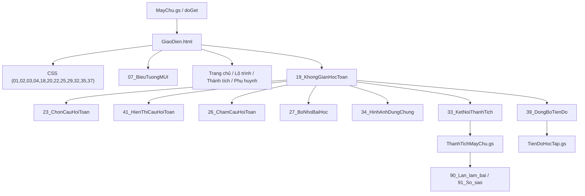

# M1 – BẢN ĐỒ PHỤ THUỘC / QUYỀN SỞ HỮU

## A. Nạp trang

## B. Điểm phụ thuộc quan trọng
| Nguồn | Dựa vào | Ranh giới an toàn khi refactor |
|---|---|---|
| `GiaoDien.html` | Nạp CSS và script theo thứ tự | Không thay đổi thứ tự không kiểm thử; một CSS chỉ nên sở hữu một component |
| `19_KhongGianHocToan` | Các global `muiIcon`, `taoHienThiCauToan`, `danhGiaCauToan`, `chonCauHoiTheoNhom`, `BO_NHO_BAI_HOC`, `TIEN_DO_HOC`, `THANH_TICH_GUI`, `HINH_ANH_APP` | Thay dependency ngầm bằng API rõ ràng nhưng giữ hành vi |
| `41_HienThiCauHoiToan` | Truyền `E`, `input`, `baseCard` vào factory | Có thể tái sử dụng; giữ nguyên contract |
| `26_ChamCauHoiToan` | Truyền `q`, getter theo tên trường | Cần regression test nhập đúng/sai cho 4 dạng |
| `33_KetNoiThanhTich` | `google.script.run` → server xác minh | Không được gửi điểm tự tính làm kết quả cuối |
| `34_HinhAnhDungChung` | `data-kl-asset` và catalog hình | Slot có thể định cấu hình, không sửa tên asset tùy tiện |
| `36_CuaVaoPhuHuynh` | Server API + kiểm soát phiên PIN | Không trộn thông tin phụ huynh vào client dùng chung |

## C. CSS ownership cần khóa lại
- `01_CSS_NenTang`: design tokens, font, reset, primitives.
- `02_CSS_TrangChu`: chỉ sở hữu layout home; biến root phải chuyển vào 01 theo lộ trình có kiểm thử.
- `20_CSS_KhongGianHocToan`: shell/math navigation/keypad basic.
- `22_CSS_BaiHocKetQua`: results component.
- `25_CSS_SuaBoCucBaiHoc`: lớp override hậu kỳ cần phân loại từng rule trước khi chuyển.
- `29_CSS_BangKetQua_V26`: kết quả/keypad hậu kỳ cần hợp nhất về đúng owner.
- `35_CSS_HinhAnhPilot`: chỉ ảnh/slot, không sở hữu logic bài.

## D. Asset slot hiện có và kế hoạch
| Slot | Hiện có | Đích |
|---|---|---|
| Trang chủ avatar / hero | `data-kl-asset`; `ROBOT_AVATAR`, `ROBOT_HERO`, `ROBOT_PRAISE` | Slot config dùng chung, có override theo trang |
| Toán lời văn | `data-ml-svg` + `HINH_ANH_APP.word(q,el)` | Mỗi câu có asset_id, độ ưu tiên rõ ràng, không lệ thuộc từ khóa |
| Robot phản hồi | Chưa có component hội thoại chung được chuẩn hóa | Avatar theo biểu cảm, lời nhắc theo skill/error |
| Bé trai, bé gái | Có manifest nhân vật, nhưng chưa lộ ra trong pilot catalog trên main | Không gắn trước khi Asset ID, variant và QA hoàn chỉnh |
